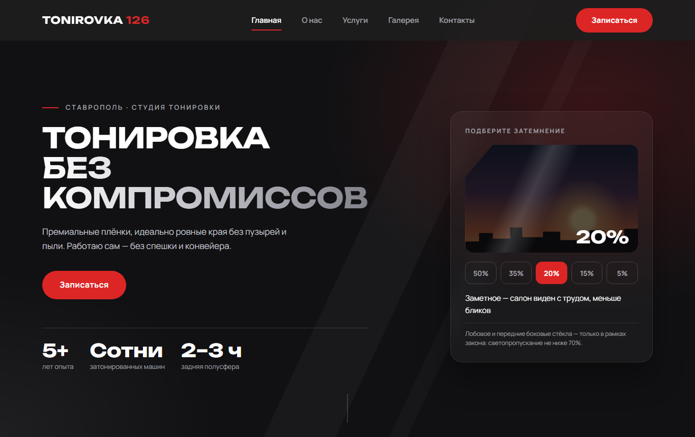

# Tonirovka 126 — лендинг студии тонировки

Одностраничный сайт для мастера по тонировке автомобилей в Ставрополе. Сделан на чистых HTML, CSS
и JavaScript, без фреймворков и сборщиков.



## Что внутри

- **Интерактивный подбор затемнения**: посетитель переключает 50/35/20/15/5% и видит, как будет выглядеть стекло.
- **Галерея работ** с лайтбоксом; работы и подписи настраиваются в одном файле `js/config.js`.
- **Форма записи**, заявки из которой приходят мастеру в Telegram через функцию Yandex Cloud,
  поэтому токен бота не лежит на сайте (есть и запасной вариант на PHP).
- **Политика конфиденциальности и согласие** на обработку персональных данных (152-ФЗ).
- Адаптивная вёрстка, анимации появления, превью для мессенджеров (Open Graph).

## Стек

HTML, CSS, JavaScript; серверная часть формы — Node.js в Yandex Cloud Functions; хостинг — Beget.

## Как посмотреть

Откройте `index.html` в браузере. Форма на компьютере работает в демо-режиме.

---

# Инструкция для владельца сайта


Одностраничный сайт на чистых HTML, CSS и JavaScript, без фреймворков.
Хостинг — бесплатный Beget, заявки из формы приходят мастеру в Telegram через Yandex Cloud Functions.

## Структура

```
index.html            главная страница (все разделы)
privacy.html          политика обработки персональных данных
consent.html          согласие на обработку персональных данных
css/style.css         все стили (содержание — в начале файла)
js/config.js          ⭐ ВСЕ НАСТРОЙКИ: контакты, галерея, данные для политики, адрес формы
js/main.js            меню, подстановка контактов, анимации появления
js/gallery.js         сетка фото и лайтбокс
js/form.js            проверка и отправка формы записи
images/               фото, иконка вкладки, картинка для превью в мессенджерах
images/gallery/       крупные фото работ (1600px), в thumbs/ — превью для сетки
server/               НЕ загружать на хостинг:
  yandex-function/      код функции для Yandex Cloud (пересылает заявки в Telegram)
  beget-paid/           запасной вариант на PHP, если когда-нибудь перейдёшь на платный Beget
```

## Частые правки

| Что поменять | Где |
|---|---|
| Телефон, Telegram, адрес, часы работы | `js/config.js` |
| ФИО, ИНН, email для политики | `js/config.js` (пока в `[скобках]` — подсвечены жёлтым) |
| Подписи к фото, порядок работ | `js/config.js`, блок `gallery` |
| Цены, тексты, вопросы | `index.html`, места помечены `ВРЕМЕННО` |
| Цвета и шрифты | `css/style.css`, раздел 1 «Переменные» |

**Новая работа в галерее:** положи крупное фото в `images/gallery/`, превью с тем же именем — в `images/gallery/thumbs/`, допиши строку в `gallery` в `config.js`.

## Как посмотреть сайт на своём компьютере и телефоне

- **Компьютер:** открой `index.html` двойным щелчком. Форма в этом режиме работает «понарошку» (демо-режим) — в консоли (F12 → Console) видно, что ушло бы мастеру.
- **Телефон:** нужен маленький локальный сервер. Если установлен Node.js, в папке сайта выполни `npx serve .`, затем на телефоне (в той же Wi-Fi сети) открой адрес вида `http://192.168.0.107:3000` — IP компьютера покажет команда `ipconfig`.

---

## Как устроена отправка заявок

Всё, что лежит в папке сайта, скачивается в браузер посетителя. Если положить туда токен бота, его прочитает кто угодно (F12) и сможет управлять ботом. Поэтому между сайтом и Telegram стоит **функция в Yandex Cloud**: она знает токен, а посетители — нет.

```
форма на сайте ──JSON──► функция в Yandex Cloud ──токен + сообщение──► Telegram ──► мастер
(Beget)                  проверяет данные,
                         хранит токен в настройках
```

Почему не PHP прямо на Beget: по правилам бесплатного тарифа (п. 3.12) скрипты могут обращаться к внешним сервисам только через порт 80, а Telegram принимает запросы ботов только по HTTPS (порт 443).

## Запуск: по шагам

### Шаг 1. Бот в Telegram
1. В Telegram открой **@BotFather** → `/newbot` → придумай имя и username (должен заканчиваться на `bot`).
2. BotFather пришлёт **токен** вида `1234567890:AAH...`. Это пароль от бота — никому его не показывай и никуда не вставляй, кроме настроек функции (шаг 3).
3. Мастер открывает своего бота и нажимает **Start** — без этого бот не сможет ему писать.
4. Узнай **chat_id** мастера: открой в браузере `https://api.telegram.org/bot<ТОКЕН>/getUpdates` (подставь токен вместо `<ТОКЕН>`). В ответе найди `"chat":{"id":123456789` — это число и есть chat_id. Если ответ пустой (`"result":[]`), мастер ещё не нажал Start — пусть нажмёт и напишет боту любое слово, потом обнови страницу.

### Шаг 2. Сайт на Beget
1. Зарегистрируйся на beget.com (тариф «Бесплатный»). Сайт получит адрес вида `логин.beget.tech`.
2. В панели открой **Файловый менеджер** → папка сайта → `public_html`. Удали стандартный файл-заглушку, если он есть.
3. Загрузи: `index.html`, `privacy.html`, `consent.html` и папки `css`, `js`, `images`.
   **Не загружай** папку `server` и этот `README.md`.
4. Открой сайт в браузере и скопируй из адресной строки его **точный адрес** без `/` в конце — например `http://my-site.beget.tech` (обрати внимание, `http` там или `https`). Он понадобится на шаге 3.

### Шаг 3. Функция в Yandex Cloud
1. Зарегистрируйся в [Yandex Cloud](https://console.yandex.cloud) и создай **платёжный аккаунт** (понадобится банковская карта; функции бесплатны до 1 млн вызовов в месяц).
2. Открой сервис **Cloud Functions** → **«Создать функцию»** → имя, например `tonirovka-form` → **«Создать»**.
3. В разделе «Последняя версия» нажми **«Создать в редакторе»**, выбери среду выполнения **Node.js** (версия 18 или новее), выключи добавление примеров кода → **«Продолжить»**.
4. В редакторе создай файл `index.js` и вставь в него весь код из `server/yandex-function/index.js`.
5. Заполни параметры версии:
   - **Точка входа:** `index.handler`
   - **Таймаут:** `10` секунд
   - **Память:** 128 МБ
   - **Переменные окружения:**
     - `TELEGRAM_TOKEN` — токен из шага 1
     - `TELEGRAM_CHAT_ID` — chat_id из шага 1
     - `ALLOWED_ORIGIN` — адрес сайта из шага 2. Для проверки с компьютера можно через запятую добавить `http://localhost:5500`, а после запуска убрать.
6. Нажми **«Сохранить изменения»**.
7. На странице функции, на вкладке **«Обзор»**, включи **«Публичная функция»** и скопируй ссылку для вызова вида `https://functions.yandexcloud.net/d4e...`.

### Шаг 4. Подключить форму
1. В `js/config.js` впиши ссылку из шага 3: `formEndpoint: 'https://functions.yandexcloud.net/d4e...'`.
2. Загрузи обновлённый `js/config.js` на Beget (заменить старый).
3. Отправь тестовую заявку с сайта — мастеру должно прийти сообщение «📩 Новая заявка с сайта».

### Если заявка не пришла
- **На сайте «Не получилось отправить заявку»** → нажми F12 → Console. Ошибка со словом `CORS` значит, что `ALLOWED_ORIGIN` не совпадает с адресом сайта буква в букву (`http`/`https`, `www`, `/` в конце).
- **Логи функции:** в консоли Yandex Cloud, на странице функции → «Логи». Там видно, что ответил Telegram, например `chat not found` (неверный chat_id или мастер не нажал Start) или `Unauthorized` (неверный токен).

---

## Чек-лист перед запуском

- [ ] Настоящие контакты в `config.js` (телефон, Telegram, адрес, часы)
- [ ] ФИО, ИНН, email в `config.js` — на страницах политики не осталось жёлтых пометок
- [ ] Цены, сроки, тексты «О нас» и ответы в FAQ сверены с мастером (поиск по слову `ВРЕМЕННО`)
- [ ] В `index.html` адрес `example.ru` в Open Graph заменён на настоящий адрес сайта
- [ ] `formEndpoint` в `config.js` заполнен, тестовая заявка пришла мастеру в Telegram
- [ ] В `ALLOWED_ORIGIN` функции убран `http://localhost:5500`, если добавлял его для проверки
- [ ] Сайт проверен с телефона
